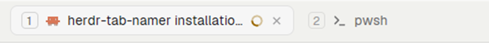

# herdr-tab-numbers

A [Herdr](https://herdr.dev) mod that shows each tab's shortcut number in the tab bar, so
you can see which `Ctrl+<n>` reaches which tab. The number is drawn, not written into the
tab's name: names stay as they are everywhere else (the agents list, `herdr-app ls`,
other mods), and a tab you move or close renumbers the others at once.



## What it does

- Each tab in the top tab bar gets a small badge before its icon: `1`, `2`, `3`, …
- A tab gets a number only when a key selects it: a `tab.select:<n>` binding in
  `keys.json` (`global`, or the shown layout's `layout:<name>` section). With Herdr's
  default keys that's tabs 1 to 9. If no `tab.select` key is bound at all, tabs 1 to 9
  are numbered anyway.
- Hover a badge to see its keys (`Ctrl+1 · Ctrl+&` when two keys select the same tab).
- Settled tabs (`tab.settle`) get no number and don't use one up, like `tab.select`.
- Everything else is Herdr's own tab bar, unchanged: pills, drag to reorder, double-click
  to rename, right-click menu, `+`, Files, Changes and the window buttons.

### Styles

The `style` prop picks the badge:

- `"keycap"` (the default): the number in a small outlined key, 16 px tall, `dim` text
  on a `border` outline (`muted` on `input` for the shown tab).
- `"plain"`: the number alone, semibold, in the same colors.

## Add it

1. Copy `mods/tab-numbers/` into `~/.config/herdr-app/mods/`.
2. Herdr's own layouts are read-only, so clone the one you use (here `main`), unless you
   already have a clone:

   ```sh
   herdr-app do layout.clone '{"name":"main","as":"my-layout"}'
   ```

3. In `~/.config/herdr-app/layouts/my-layout.json`, point the top bar block
   (`"id": "tabs"`) at this mod instead of `tabs`:

   ```json
   { "id": "tabs", "type": "block", "content": { "mod": "tab-numbers" },
     "size": { "px": 42 }, "window_drag": true }
   ```

   For the plain style: `"content": { "mod": "tab-numbers", "props": { "style": "plain" } }`.

4. Check it: `herdr-app check ~/.config/herdr-app/mods/tab-numbers`.

To go back, set the block's mod to `tabs` again.

## Why it is a whole tab bar

A Herdr mod can't draw inside another mod, and the shipped tab bar has no slot for a
number. So `mods/tab-numbers/main.js` is a copy of Herdr's `mods/tabs/main.js` with three
small additions, each marked `tab-numbers:`. The rules live in `numbers.js` (pure
functions, tested with Node).

The copy is not updated with Herdr. `upstream/tabs-main.js` is the shipped file it was
made from (herdr-app **0.1.13**). After a Herdr update, run:

```sh
node scripts/check-upstream.mjs      # or: npm run upstream
```

It says whether Herdr's tab bar changed, and shows the diff when it did. Port the change
into `mods/tab-numbers/main.js` (keeping the `tab-numbers:` lines), copy the new shipped
file over `upstream/tabs-main.js`, and update the version above.

## Develop

Plain JavaScript, no build step.

```sh
node --test                              # numbering rules
herdr-app check mods/tab-numbers         # loads the mod
node scripts/check-upstream.mjs          # has Herdr's tab bar changed?
```

## License

Apache-2.0, like Herdr, whose tab bar this mod is built from. See [NOTICE](NOTICE).
