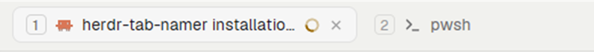

# Tab numbers

Herdr's own tab bar, with each tab's shortcut number in a small badge before its icon:
`1`, `2`, `3`, so you can see which `Ctrl+<n>` reaches which tab. The number is drawn,
not part of the tab's name, so names elsewhere (the agents list) don't change.

## What you see

- The top tab bar, exactly as Herdr ships it (42 px in `main`): tab pills, `+`, Files,
  Changes, and on Windows and Linux the window buttons.
- In each numbered pill, first in the row (before the program icon, 7 px gap as the
  pill's other parts):
  - `keycap` (default): a box 16 px tall, at least 16 px wide, 4 px side padding,
    radius 4, 1 px border, the number centered in 10.5 px UI text. Border `border` and
    text `dim`; on the shown tab, border `input` and text `muted`.
  - `plain`: the number alone, 11.5 px semibold, `dim` (`muted` on the shown tab).
- Hover a badge: a tooltip with the keys that select that tab, in reading form joined by
  ` · ` (`Ctrl+1 · Ctrl+&`), or `Tab <n>` when none is bound.

## How it behaves

- The number is the tab's position among the space's tabs that aren't settled, the way
  `tab.select:<n>` counts. Settled tabs get none and don't use a number up.
- A tab is numbered only when some key runs `tab.select:<n>` for its number: bindings
  from `keys()` in the `global` section or the shown layout's `layout:<name>` section
  (`shared("layout")`). Other sections (`terminal`, `mod:*`) don't count. When no
  `tab.select` key is bound in those sections, tabs 1 to 9 are numbered.
- Key names read `ctrl-shift-1` as `Ctrl+Shift+1` (modifiers capitalized, a one-character
  key upper-cased).
- Agent status (working spinner, `blocked` / `done` dot), clicks, drag to reorder,
  double-click rename, right-click menu and scrolling are the shipped tab bar's,
  untouched. Moving or closing a tab renumbers the rest on the next render.

## Built from

- `mods/tab-numbers/`: `mod.json` (`{ "place": "none", "title": "Tab numbers" }`),
  `main.js` (Herdr 0.1.13's `mods/tabs/main.js` plus three hunks marked `tab-numbers:`:
  the imports, the badge builder in `render`, and one `.when(...)` child before the icon),
  `numbers.js` (pure rules: `selectKeys`, `keyLabel`, `tabNumbers`, `tooltip`).
- Layout: the top bar block's `content.mod` is `tab-numbers` instead of `tabs`;
  optional `props.style`: `"keycap"` | `"plain"`.
- `herdr`: `keys()` and `props()` on top of what the shipped tab bar uses. Icons come from
  the shipped mods' folders (`mods/tabs/`, `mods/pane/`, `mods/workspace-chrome/`, …).
- No programs run, no network, no files read.

## Watch out

- A mod can't draw inside another mod, so this is a whole tab bar: a copy of the shipped
  one. It doesn't follow Herdr's updates by itself. `upstream/tabs-main.js` is the shipped
  file it was made from; `scripts/check-upstream.mjs` diffs it against the installed
  `mods/tabs/main.js`.
- Writing the number into tab names (`tab.rename`) instead would show it in the agents
  list too and take room there; this mod only draws.
- `keys()` returns action strings: a binding in object form
  (`{ "command": "tab.select", "args": … }`) isn't recognised and gets no number.
- The shipped tab bar's localStorage (the side panel per space) belongs to the mod copy,
  so switching to this mod starts that memory empty once.

## Done when

- `herdr-app check mods/tab-numbers` passes and `node --test` passes.
- With Herdr's default keys, a space with three tabs shows `1`, `2`, `3`; `Ctrl+2` shows
  the tab with the `2` badge.
- Dragging the third tab to the front shows it as `1` at once; tab names don't change
  (`herdr-app ls`).
- With `ctrl-1` and `ctrl-&` both bound to `tab.select:1`, hovering badge `1` shows
  `Ctrl+1 · Ctrl+&`.
- Removing `tab.select:3` from `keys.json` removes the `3` badge only.
- `"style": "plain"` shows bare numbers.
